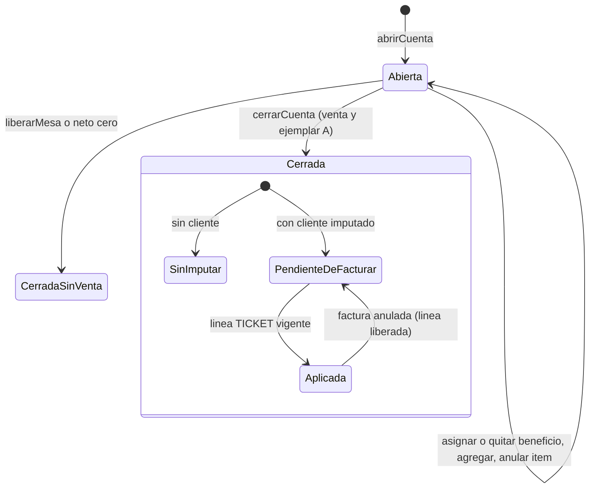
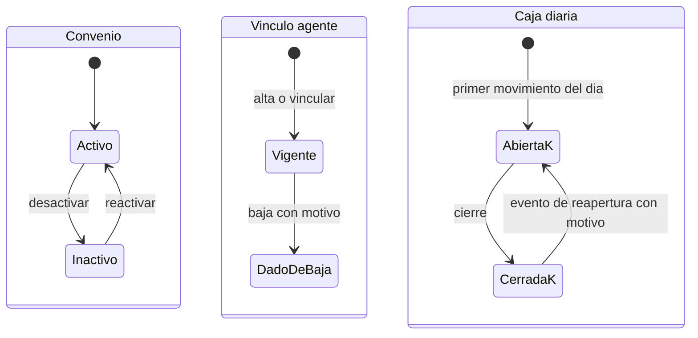

# Diseño: clientes, convenios y facturación externa (2026-10-26)

Estado: **diseño en papel, a validar por el dueño. Sin código ni migraciones.** Es el piloto de la regla del dueño del 2026-10-26 (`AGENTS.md`, «Diseño de módulos y features nuevos»). Verificado contra el código de la rama `alegp/stoic-davinci-185dm4` en `b201e7e7` (solo lectura).

Insumos: `docs/validacion-features-faltantes-2026-10-26.md` (la «validación», con las tres aclaraciones del dueño del 2026-10-26); el borrador «Features faltantes de motor2» (el «borrador»: a validar, no es verdad); `prisma/schema.prisma`; `src/core/pos`, `src/server/actions/pos`, `src/core/permisos/acciones.ts`, `src/core/moneda.ts`; ADR-001, 008, 009, 011, 013, 027, 028, 029, 031, 032 y 038; `docs/pendientes-sesion-2026-10-22.md` (GO-3d).

Estados de cada decisión: **CONFIRMADA** (dicha por el dueño; se cita dónde), **PROPUESTA** (de este diseño), **PENDIENTE** (falta decidir), **NO VERIFICADA** (no se pudo comprobar en el código).

## 0. Principios que este diseño respeta

| Principio | Estado y fuente |
|---|---|
| Modelo completo en papel; se migran SOLO las tablas de la etapa que se implementa, con puntos de extensión (FK opcionales, estados TEXT + CHECK, historial que solo agrega); migraciones aditivas con `down.sql` | CONFIRMADA (`AGENTS.md`, regla del 2026-10-26) |
| Lo que solo hace al sistema más general se posterga | CONFIRMADA (`docs/hoja-de-ruta-despues-de-la-fusion.md`, punto (4), regla del 2026-10-11) |
| No repetir tablas que nadie escribe (`Venta`, `FacturaProveedor*`, `NotaCreditoProveedor*`, `ImputacionDeGasto`, `PlanDeCostos`, `CentroDeCostos`) | CONFIRMADA (consigna; hallazgo 4 de la validación) |
| La herramienta es flexible: nada de automatismos, vigencias ni fechas que el dueño no pidió | CONFIRMADA (`docs/pendientes-sesion-2026-10-22.md`, 12.ª parte) |
| Lo nuevo nace excluido (fail-closed) | CONFIRMADA (pendientes 2026-10-22, «Principio decidido», 3.ª parte) |

Reglas de ingeniería que el diseño declara en cada comando: transacción `SERIALIZABLE` (`conTransaccionSerializable`, `src/lib/transaccion-serializable.ts`) con `SELECT … FOR UPDATE` de la fila que arbitra cuando la regla cruza filas (precedente: `src/server/actions/catalogo/casos-de-uso/fijar-disponibilidad-de-hoy.ts`); índices únicos parciales como árbitro (nunca «leer y después escribir»); idempotencia I3 (clave única global + huella + mensaje) cuando el comando crea filas; atomicidad (escritura y auditoría en la misma transacción); aislamiento por empresa (RLS `aislamiento_empresa`) y por sucursal (ADR-028); autorización en el servidor por clave con piso (ADR-008, ADR-027), fail-closed; dinero `Decimal(14,2)` en la moneda de la empresa (`Empresa.moneda`), aritmética en `src/core/moneda.ts`; fechas en la zona de la empresa (`Empresa.zonaHoraria`, `diaDeCalendario` en `src/core/tiempo/zona-horaria.ts`); trazabilidad (`registrarCambioAuditado`, `src/server/auditoria/registrar-cambio-auditado.ts`; lo que se corrige se anula con un registro nuevo, nada se borra); saldos siempre derivados.

---

## A. Inventario (solo lo que agrega a la tabla de la validación)

La tabla por ítem (F1 a F17) está en la validación, «Estado por ítem»; no se repite. Lo nuevo, verificado en el código:

**EXISTE y se reutiliza**
- `precioCobradoConDescuentos` (`src/core/carta/descuento-producto.ts`): única definición de «descuento de producto + descuento de la cuenta = rige el mayor, nunca en cascada» (decisión del dueño del 2026-10-01). La usan el cierre, el ticket y el total de la mesa. Un descuento por categoría que reutilice `Cuenta.descuentoPorcentaje` **no exige tocar `cerrarCuenta`**.
- `asignarClienteACuentaCasoDeUso` (`src/server/actions/pos/casos-de-uso/asignar-cliente-a-cuenta.ts`): SERIALIZABLE, solo cuenta abierta de la sucursal (`cuentaAbiertaDeSucursal`), % congelado (D7), dos filas de auditoría, y `registrarCambioAuditado` no escribe la que no cambió. Es el molde de «asignar beneficio».
- `wherePromoOfrecidaEn` (`src/core/carta/promo-sucursal.ts`): la carta pública (`src/server/lecturas/carta/menu.ts`) y el POS usan el MISMO filtro. Consecuencia: **una oferta activa en la sucursal se veía en la carta pública**; no había «solo salón» (pendientes 2026-10-22, 14.ª parte). **RESUELTO (2026-10-27):** la promo tiene el interruptor `PromoCarta.soloSalon` y `wherePromoOfrecidaEn(sucursalId, audiencia)` recibe la audiencia (`"publico"` no ofrece las promos en «solo salón»; el POS pide `"salon"`); ver `docs/diseno-promo-solo-salon-2026-10-26.md` y el ADR-032 (actualización 2026-10-27). La migración `20261026120000_promo_carta_solo_salon` va ANTES que el código y requiere autorización expresa en cada base real.
- `PromoCarta` (precio fijo, `version` optimista, `activa`) y `EntradaDeCupo` (admite productos fuera de la carta): son la «oferta» del convenio.
- `validarCuit` con dígito verificador (`src/core/fiscal/cuit.ts`). `CONDICIONES_IVA` (`src/core/fiscal/iva.ts`) es la lista del EMISOR (RI, Monotributo, Exento): **no sirve para el receptor** (falta consumidor final).
- Clave foránea con discriminador (columna constante en la FK compuesta; precedentes M4.3 y M5, ADR-029 §10 y §11): sirve para que la base imponga «empresa» y «persona» sin disparadores.
- `ModuloEmpresa` + catálogo en código (`src/core/modulos/catalogo.ts`): `clientes_basico` es de soporte (sin filas); `salon` lo requiere. Agregar un módulo no requiere migración.
- Clasificación de tablas (`test/setup/clasificacion-de-tablas.ts`): `Cliente` es `DE_EMPRESA`; `Cuenta` es `HEREDADA` de `Mesa`.

**PARCIAL**
- Reporte «Descuentos por cliente» (`src/core/reportes/descuentos-clientes.ts`): agrupa por `Operacion.clienteId`. Un descuento **anónimo** no tendría cliente y no aparecería. Hace falta otro corte («por concepto»), que se deriva por `CuentaItem.operacionId` → `Cuenta`.
- El importe de un ticket cerrado **puede bajar** por anulaciones posteriores; el ejemplar B lo refleja (`src/server/actions/pos/casos-de-uso/emitir-ticket-corregido.ts`). Afecta a la aplicación de tickets a facturas (sección C).
- Puntos de venta PROPIOS de la empresa: ADR-001 dice que el gerente los administra, pero **no encontrado** en `prisma/schema.prisma` (solo existe `PuntoDeVentaDeProveedor`).

**FALTA**: convenio, vínculo agente–empresa, descuento por categoría, `Cliente.tipo`, documento y condición de IVA del receptor, factura externa y su composición, cobros, medios de pago, caja diaria. Ninguna venta tiene comprobante propio (pendientes 2026-10-22, «Comprobantes»).

**SE SOLAPA**
- «Marcar para qué cliente o agencia es un menú» (pendientes 2026-10-22, 14.ª parte y «Orden de trabajo») **es el mismo vínculo** que «oferta permitida por convenio»: una sola tabla lo cubre (sección F).
- «Cliente especial consumidor final» del borrador vs `Cuenta.clienteId = null` (hoy significa «sin cliente»).
- `MedioPago` del borrador vs `FacturaProveedor.medioPagoDeclarado` (texto).
- `Venta` (cabecera, nadie la escribe) vs «ticket facturable»: este diseño se apoya en `Cuenta`, que sí se escribe (sección B).

---

## B. Mapa de dominio

Marcas: **EXISTE** (tabla en uso), **REUTILIZA** (existe y este diseño la usa sin tocarla o con columnas nuevas), **NUEVA** (se migra en la etapa indicada), **DIFERIDA** (en papel; se migra recién en su etapa).

```mermaid
erDiagram
  Empresa ||--o{ Sucursal : tiene
  Sucursal ||--o{ Mesa : tiene
  Mesa ||--o{ Cuenta : "una abierta a la vez"
  Empresa ||--o{ Cliente : "catalogo de empresa"
  Cliente ||--o{ AgenteDeCliente : "como empresa"
  Cliente ||--o{ AgenteDeCliente : "como persona"
  Cliente ||--o{ Convenio : pacta
  Convenio ||--o{ ConvenioOferta : permite
  PromoCarta ||--o{ ConvenioOferta : "es oferta de"
  Convenio ||--o{ ConvenioProducto : "permite (b)"
  Producto ||--o{ ConvenioProducto : "es producto de"
  DescuentoPorCategoria |o--o{ Cuenta : "concepto anonimo"
  Cliente |o--o{ Cuenta : "imputado"
  Convenio |o--o{ Cuenta : "beneficio"
  AgenteDeCliente |o--o{ Cuenta : "quien consumio"
  Cuenta ||--o{ CuentaItem : lineas
  Cuenta ||--o{ PromoCuenta : ofertas
  PromoCarta ||--o{ PromoCuenta : instancia
  Cuenta ||--o{ EjemplarTicket : "papel A B"
  CuentaItem }o--o| Operacion : "venta al cerrar"
  Cliente |o--o{ Operacion : "copia del imputado"
  Cuenta |o--o| Venta : "cabecera sin escritor"
  Sucursal ||--o{ FacturaExterna : emite
  Cliente |o--o{ FacturaExterna : receptor
  FacturaExterna ||--o{ ConceptoFacturaExterna : compone
  Cuenta ||--o{ ConceptoFacturaExterna : "a lo sumo una vigente"
  CentroDeCostos |o--o{ ConceptoFacturaExterna : "unidad de negocio"
  Cliente ||--o{ CobroDeCliente : paga
  MedioDePago ||--o{ CobroDeCliente : medio
  CobroDeCliente ||--o{ ImputacionDeCobro : "se aplica"
  FacturaExterna ||--o{ ImputacionDeCobro : "recibe"
  Sucursal ||--o{ CajaDiaria : "una por dia local"
  CajaDiaria ||--o{ MovimientoDeCaja : "solo agrega"
  CobroDeCliente |o--o| MovimientoDeCaja : ingreso
  FacturaProveedor |o--o{ MovimientoDeCaja : egreso

  Empresa {
    marca EXISTE "tenant; moneda y zonaHoraria"
  }
  Sucursal {
    marca EXISTE "GOBIERNO"
  }
  Mesa {
    marca EXISTE "PROPIA"
  }
  Cliente {
    marca REUTILIZA "N3: + tipo PERSONA o EMPRESA; documento DIFERIDA"
  }
  AgenteDeCliente {
    marca NUEVA "etapa N3; DE_EMPRESA"
  }
  Convenio {
    marca NUEVA "etapa N1; DE_EMPRESA"
  }
  ConvenioOferta {
    marca NUEVA "etapa N1; DE_EMPRESA"
  }
  ConvenioProducto {
    marca DIFERIDA "forma (b), a pedido"
  }
  DescuentoPorCategoria {
    marca NUEVA "etapa N1b; DE_EMPRESA"
  }
  PromoCarta {
    marca REUTILIZA "la oferta"
  }
  Producto {
    marca EXISTE "catalogo"
  }
  Cuenta {
    marca REUTILIZA "+ convenioId N1, descuentoCategoriaId N1b, agenteVinculoId N3"
  }
  CuentaItem {
    marca EXISTE "precio congelado"
  }
  PromoCuenta {
    marca EXISTE "snapshot de la oferta"
  }
  EjemplarTicket {
    marca EXISTE "numero y ejemplar"
  }
  Operacion {
    marca EXISTE "clienteId = imputado"
  }
  Venta {
    marca EXISTE "sin escritor; no se usa"
  }
  FacturaExterna {
    marca DIFERIDA "facturacion N0"
  }
  ConceptoFacturaExterna {
    marca DIFERIDA "N2 composicion; N3 aplicacion"
  }
  CentroDeCostos {
    marca REUTILIZA "unidad de negocio ADR-031"
  }
  CobroDeCliente {
    marca DIFERIDA "facturacion N4"
  }
  MedioDePago {
    marca DIFERIDA "catalogo de empresa"
  }
  ImputacionDeCobro {
    marca DIFERIDA "pago parcial o a cuenta"
  }
  CajaDiaria {
    marca DIFERIDA "caja N2"
  }
  MovimientoDeCaja {
    marca DIFERIDA "caja N0"
  }
  FacturaProveedor {
    marca EXISTE "modelo sin escritor ADR-029"
  }
```

Decisiones del mapa:

1. **Persona vs empresa.** Un solo catálogo `Cliente` con `tipo` (`PERSONA` | `EMPRESA`, NULL = «pendiente de completar»). «Empresa» en el repo es el tenant (ADR-001); la empresa cliente es un `Cliente`. PROPUESTA.
2. **Consumidor vs imputado.** `Cuenta.clienteId` pasa a significar **«a quién se imputa»** (la empresa, en el caso del agente; la persona, en el caso del empleado con %). Quién consumió sale del vínculo (`Cuenta.agenteVinculoId` → persona). Por qué así y no al revés: `cerrarCuenta` copia `Cuenta.clienteId` a `Operacion.clienteId` y el reporte de descuentos agrupa por ese campo; con esta lectura **ni el cierre ni el reporte cambian**, y lo que se factura después es lo imputado. PROPUESTA.
3. **Beneficio de la cuenta: uno solo, sin tabla nueva.** Se deriva de qué columna está puesta: `convenioId` → CONVENIO; `descuentoCategoriaId` → CATEGORÍA (anónimo); si no, `descuentoPorcentaje` con `clienteId` → CLIENTE (identificado, lo de hoy); nada → sin beneficio. El % aplicado siempre vive en el `descuentoPorcentaje` que ya existe (snapshot). Un CHECK impone «a lo sumo uno». Un solo beneficio por ticket: CONFIRMADA como supuesto de trabajo (validación, 3.ª aclaración, supuesto 1); la acumulación queda como pregunta (H4).
4. **Aplicación de un ticket a una factura: UNA representación.** Se elige **la línea de composición de tipo TICKET** (`ConceptoFacturaExterna.cuentaId`) con un **índice único parcial** sobre `(empresaId, cuentaId)` de las líneas vigentes (la línea lleva su propia marca `liberadaEn`, que se llena en la misma transacción que anula la factura, porque un índice parcial no puede mirar la cabecera). Descartadas: `Cuenta.facturaAplicadaId` (escribe una tabla caliente de sucursal desde un documento y deja dos fuentes del importe), `estado = APLICADO` en la cuenta (el estado se deriva; hoy la cuenta solo tiene abierta o cerrada) y una tabla `AplicacionTicket` aparte (duplica la línea de composición y su `importe` sugería aplicación parcial, contradicción 1 de la validación). La aplicación es del ticket ENTERO, por su importe vigente derivado. PROPUESTA.
5. **El ticket facturable es la `Cuenta` cerrada con venta**, no `Venta` (que nadie escribe). La venta de mostrador DEL POS es una `Cuenta` del puesto «Mostrador» (`Mesa.tipo = MOSTRADOR`, `docs/diseno-ventas-salon-y-mostrador-2026-10-26.md` y `docs/adr/ADR-039-el-mostrador-es-un-puesto-del-salon.md`): lleva cliente, ticket y todo lo de esta sección sin nada propio, así que es aplicable igual que una mesa (resuelve el «PENDIENTE para mostrador»; CONFIRMADA por el dueño el 2026-10-26, H5). Lo que sigue sin ser aplicable es la carga directa sin ticket (`registrarVenta`, «Carga de ventas sin ticket»: no tiene cuenta ni cliente, D6). PROPUESTA.
6. **Cobrado no es un estado del ticket ni de la cuenta**: sale de los cobros imputados a la factura. Cerrar cuenta ≠ cobrar: CONFIRMADA (dueño, 2026-10-26, consigna de este diseño; coherente con el hallazgo 2 de la validación y con B5 de `docs/plan-tomar-pedido-2026-09-25.md`, que unía las dos cosas solo porque no había caja).
7. **Cuenta corriente = saldo derivado** por cliente imputado: Σ facturas confirmadas no anuladas − Σ imputaciones de cobros vigentes. Sin columna ni `saldoResultante`. «Cuenta corriente» no es un medio de pago: es lo que queda sin cobrar. PROPUESTA.
8. **Reservas**: por ahora solo una referencia externa de texto en la línea de composición (`referenciaReserva`). Existe un repositorio aparte `reservations-api` (citado en la validación y en `docs/arquitectura-modularidad-server-actions-2026-09-17.md`): NO VERIFICADA su API. DIFERIDA.
9. **Unidad de negocio = `CentroDeCostos`** (ADR-031), no una tabla `UnidadNegocio` nueva. PROPUESTA.
10. **Compras** se conecta solo por la caja: un egreso puede referenciar una `FacturaProveedor` (modelo de ADR-029, hoy `condicionPago` solo `CONTADO_PAGADA`). La cuenta corriente de proveedores es otro libro, no se mezcla con la de clientes. DIFERIDA.

---

## C. Ciclos de vida y estados

Regla común: los estados que se GUARDAN son TEXT + CHECK; todo lo demás se DERIVA. Nada se borra: se anula, se da de baja o se desactiva con quién, cuándo y motivo.

**Ticket facturable (`Cuenta`)**. Guardado hoy: abierta (`cerradaEn` NULL) o cerrada. El resto es derivado. PROPUESTA.

- Corregir con la cuenta abierta: se reasigna el beneficio (auditado). Cerrada: el beneficio y el imputado quedan congelados; cambiar el cliente de una cuenta cerrada **no existe hoy** y queda DIFERIDO (exigirá permiso, motivo y registro nuevo).
- Anular ítems después del cierre baja el importe vigente (ejemplar B). Con una línea TICKET vigente, esa anulación se rechaza hasta liberar la factura o cargar una nota de crédito externa (PROPUESTA; afecta a `anular_venta`, a decidir en la etapa de facturación).

**Factura externa**. Guardado: `BORRADOR` → `CONFIRMADA`, y la anulación (tres columnas juntas, como `NotaCreditoProveedor`). Derivados: composición (`incompleta`/`completa`, Σ líneas vs total) y cobro (`impaga`/`parcial`/`cobrada`). Anular libera el número y las líneas TICKET en la misma transacción; el dinero no se edita: se anula y se vuelve a cargar (precedente ADR-029 §4). DIFERIDA.

**Convenio**. `ACTIVO` ↔ `INACTIVO` (UPDATE por columna, con versión optimista y auditoría). Nunca se borra. Inactivarlo no toca lo ya cargado en cuentas abiertas; desde ese momento la cuenta con ese convenio no acepta ítems nuevos (fail-closed). PROPUESTA.

**Vínculo agente–empresa**. `VIGENTE` → `DADO_DE_BAJA` (baja = `bajaEn`, `bajaPorId`, `motivoBaja` juntos; UPDATE guardado por `bajaEn IS NULL`). Volver a vincular es una fila nueva. Las cuentas que lo usaron lo siguen apuntando (FK RESTRICT). La baja no toca cuentas abiertas (mismo criterio que desactivar un cliente hoy). PROPUESTA.

**Caja diaria** (DIFERIDA). Una por sucursal y día local de la empresa: `ABIERTA` → `CERRADA`; reabrir es un **evento** nuevo con motivo, no un UPDATE que borre el cierre; corregir un movimiento es un contramovimiento.

---

## D. Escalera de producto N0 a N5 por módulo

Acumulativa: cada peldaño suma datos o controles y no rompe lo cargado. Los **controles de integridad** (aplicación única, unicidad del número, aislamiento) **no son peldaños**: rigen desde que existe la tabla. Referencias: (E) existe, (M) modelo escrito sin escritor, (F) falta.

Eje de **formalidad** (cuánto control):

| Módulo | N0 | N1 | N2 | N3 | N4 | N5 |
|---|---|---|---|---|---|---|
| Clientes y descuentos | Cliente identificado con % (E) | Descuento por categoría anónimo, con concepto y permiso propio (F) | `tipo` persona/empresa (F) | Documento y condición de IVA del receptor (F) | Límite de crédito (F) | Historial auditado de datos fiscales (base: `RegistroAuditoria`, E) |
| Convenios | Sin convenio: el % del cliente (E) | Ofertas permitidas, solo lo pactado (F) | Precio pactado: oferta propia, o % sobre productos de la carta (F; ver H3) | Agente–empresa: consume uno, se imputa a la otra (F) | Tope y cuenta corriente, advierte (F) | Consumo por agente y período (F) |
| Facturación externa | Factura con cliente e importe (F) | Tipo de comprobante, punto de venta, número y fecha (F) | Composición con conceptos, restante a cero (F) | Aplicar tickets y referencia de reserva o seña (F) | Cobros y medios de pago (F) | Cuenta corriente y conciliación (F) |
| Restaurante / tickets | Cuenta cerrada con ticket numerado (E) | Cliente o beneficio en la cuenta (E, parcial) | Ejemplar corregido (E) | Imputado y «pendiente de facturar» derivado (F) | Aplicación a factura (F) | Cambio de cliente después del cierre, auditado (F) |
| Alojamiento | Referencia de reserva en el concepto (F) | Seña como concepto con referencia (F) | Consumos del POS asociados a la referencia (F) | Reserva propia o integrada (DIFERIDA) | Cargos de estadía (F) | Saldo por reserva (F) |
| Caja | Cobro con medio de pago (F) | Clasificar por centro de costos (M) | Cierre diario por sucursal (F) | Checkpoint (F) | Corrección y reapertura por evento (F) | Conciliación con facturas y cobros (F) |
| Compras | Anotar la compra (E) | Compra con proveedor y N.º (E) | Factura de proveedor repartida (M, ADR-029) | Recepción separada por sucursal (M) | Tres vías con tolerancias (F) | — |

Eje de **detalle** (perillas independientes, no peldaños): IVA desglosado (compras: `Empresa.llevaIvaDeCompras`, E; ventas: F); unidad de negocio (`PlanDeCostos`/`CentroDeCostos`, M); lote y vencimiento (E en compras); dato mínimo del residente (F, PENDIENTE); referencia de reserva (F).

**Dónde vive la configuración** (PROPUESTA). Sin `NivelModulo`, `ConfiguracionNivelEmpresa`, `PoliticaEmpresa` ni `ReglaAplicacion`:
- ¿La empresa tiene el peldaño? → `ModuloEmpresa` (lo escribe solo la plataforma, ADR-011). Cada peldaño que agrega funcionalidad es un módulo del catálogo en código (por ejemplo `convenios`), con `requiere` para el orden.
- ¿Esta sucursal lo usa? → `CapacidadSucursal` (opt-out, ADR-009).
- ¿Quién? → clave con piso en `ACCIONES` y `PermisoRol`.
- Perillas de comportamiento (bloquear o advertir el tope, exigir composición) → columna de `Empresa` escrita solo por la plataforma, como `llevaIvaDeCompras`, **recién cuando tenga lector**.
- El «nivel» que se muestra se calcula de los módulos activos (función pura en `src/core/modulos`).
- Por qué: las cuatro piezas ya existen, con guard, guardianes y consola; una tabla de niveles duplicaría `ModuloEmpresa` y ADR-013 (validación, «Solapan»), y una tabla de reglas contradice que cada regla se declara una vez en código. Se revisa solo si un segundo módulo necesita un nivel que no se pueda expresar como conjunto de módulos.

**«Pendiente de completar»** (PROPUESTA): se deriva de un NULL, nunca de un relleno. Por ejemplo, un `Cliente` sin `tipo` muestra «Tipo: pendiente de completar» y no puede ser empresa de un agente (la FK con discriminador lo impide); una factura sin líneas muestra «Composición: pendiente»; una factura migrada lleva `origen = MIGRACION` y «no reconstruida» (precedente `FacturaProveedor.origen`). Sin backfill que invente datos.

---

## E. Escalera de diseño, niveles 1 a 5, para la primera tajada

Tajada: **«Cliente, agente–empresa, convenio y descuentos en el POS»**. Peldaños: N0 cliente con % (existe) → N1 convenio con ofertas permitidas → N2 precio pactado → N3 agente–empresa → N4 tope y cuenta corriente. El orden es PROPUESTA de la validación (2.ª aclaración) y lo toma esta consigna. El descuento por categoría anónimo entra como **N1b**, otra configuración (CONFIRMADA: validación, 3.ª aclaración).

### Nivel 1. Propósito y alcance
- **Para qué**: que la cuenta de una mesa diga a quién beneficia y a quién se imputa, y qué se le puede vender, para (a) cobrar el precio correcto, (b) impedir vender a un convenio lo no pactado (CONFIRMADA: «solo se le pueda generar ticket de lo pactado», validación, 2.ª aclaración), (c) dejar el concepto de todo descuento (supuesto 2 de la 3.ª aclaración) y (d) dejar el ticket listo para facturarlo a la empresa más adelante.
- **Fuera de alcance**: facturar, cobrar, saldo, caja, la carga directa sin ticket (`registrarVenta`: no lleva cliente, D6; el mostrador del POS SÍ está dentro, porque es una cuenta de un puesto del salón: ADR-039), cambiar el cliente de una cuenta cerrada, dividir la cuenta por persona (`Cuenta.comensales` solo mide rotación).

### Nivel 2. Actores y contexto
- **Mozo u operario** (POS, sucursal activa): asigna el beneficio y carga ítems.
- **Administrador** (rango 3 hoy; el «encargado» de rango 2 llegará con F3 de ADR-027): administra clientes, convenios, categorías y agentes.
- **Gerente**: sin rol propio en la tajada.
- **Personas**: el agente que consume (persona), la empresa cliente (convenio), el empleado (descuento identificado), el residente (descuento anónimo).
- **Sistemas**: Promociones y Carta (las ofertas, ADR-032), el registro de módulos, el gate.
- **Contexto técnico**: `Cliente` es de empresa; `Cuenta` hereda la sucursal de `Mesa`; la oferta se ofrece por sucursal (`PromoCartaSucursal`); el día es el de la zona de la empresa.

### Nivel 3. Casos de uso
| # | Caso de uso | Peldaño |
|---|---|---|
| CU1 | Asignar o quitar el beneficio de una cuenta abierta: cliente con %, categoría anónima, convenio, o agente → empresa → convenio | N0 (existe), N1b, N1, N3 |
| CU2 | Definir un convenio: alta, nombre, activar o desactivar | N1 |
| CU3 | Agregar o quitar una oferta permitida de un convenio (llevar al estado) | N1 |
| CU4 | Agregar ítems a una cuenta con convenio: solo ofertas permitidas, activas y ofrecidas en la sucursal | N1 |
| CU5 | Definir una categoría de descuento (nombre y %) | N1b |
| CU6 | Alta o vinculación de un agente desde la ficha de la empresa cliente, y atajo desde el POS: crear la persona si no existe o vincular una existente; dar de baja el vínculo (CONFIRMADA: validación, 3.ª aclaración) | N3 |
| CU7 | Ver beneficios por concepto (cliente, categoría, convenio) | N1b |
| CU8 | Ver el saldo y el tope del imputado al asignar | N4 (DIFERIDA) |

### Nivel 4. Conceptos y ciclo de vida
- **Beneficio de la cuenta**: NINGUNO | CLIENTE (% identificado) | CATEGORÍA (% anónimo) | CONVENIO (acceso restringido a ofertas; precio de la oferta). Uno solo (decisión 3 de B).
- **Imputado**: `Cuenta.clienteId`. **Consumidor**: la persona del vínculo, si hay agente; si no, el mismo imputado o nadie.
- **Convenio**: pacto de la empresa con un cliente; lista de ofertas permitidas; el precio es el de la oferta «y fin» (CONFIRMADA: validación, 3.ª aclaración, forma (a)). La forma (b), productos de la carta a precio de carta, y el descuento sobre (b) son configuraciones aparte (CONFIRMADA, misma fuente; DIFERIDAS).
- **Oferta permitida**: el par (convenio, `PromoCarta`). Es lo mismo que «para qué cliente es este menú» (A, «Se solapa»).
- **Categoría de descuento**: concepto con %, sin persona.
- **Vínculo agente–empresa**: persona y empresa, vigente o dado de baja.
- Ciclos: sección C.

### Nivel 5. Invariantes y políticas
| # | Invariante | Lo impone | Estado |
|---|---|---|---|
| I1 | A lo sumo un beneficio por cuenta | CHECK en `Cuenta` | PROPUESTA (supuesto 1 del dueño) |
| I2 | El % aplicado es un snapshot congelado al asignar | ya existe (D7) | EXISTE |
| I3 | Con convenio, el imputado es el cliente del convenio y no hay % | FK compuesta `(empresaId, convenioId, clienteId)` + CHECK | PROPUESTA |
| I4 | Con convenio, solo entran ofertas permitidas, activas en el convenio, ofrecidas en la sucursal y vigentes; sin ninguna, no entra nada | caso de uso `agregarItems` y el selector | PROPUESTA |
| I5 | Lo ya cargado no cambia si el convenio o la oferta cambian después | lectura al agregar, nunca al cerrar (como la vigencia de la promo, ADR-032 D-7) | PROPUESTA |
| I6 | No se asigna un convenio a una cuenta con ítems vigentes fuera de él | caso de uso (lee los ítems con la fila tomada) | PROPUESTA |
| I7 | Cuenta cerrada: beneficio, imputado y agente inmutables | `cuentaAbiertaDeSucursal` | EXISTE |
| I8 | El vínculo une una empresa (`tipo = EMPRESA`) y una persona (`tipo = PERSONA`), distintas; a lo sumo un vínculo vigente por par | FK con discriminador + CHECK + único parcial | PROPUESTA |
| I9 | Con agente, el imputado es la empresa del vínculo | FK compuesta `(empresaId, agenteVinculoId, clienteId)` | PROPUESTA |
| I10 | Todo cambio de beneficio, convenio, categoría o vínculo deja auditoría en la misma transacción | `registrarCambioAuditado` | PROPUESTA |
| I11 | El descuento por categoría va sin cliente, con concepto y con permiso propio | CHECK + clave | PROPUESTA (supuestos 2 y 3) |
| I12 | Convenio, oferta permitida, categoría y vínculo no se borran | privilegios: sin DELETE | PROPUESTA |
| I13 | % `Decimal(5,2)`, 0 < % < 100 (`validarPorcentajeDescuento`); precios `Decimal(14,2)` en la moneda de la empresa; piso de $0,01 (`precioConDescuento`) | base + `src/core/moneda.ts` | EXISTE |
| I14 | Desactivar un cliente, un convenio o dar de baja un vínculo no revierte cuentas en curso | caso de uso | EXISTE para el cliente; PROPUESTA el resto |
| I15 | El tope advierte y no bloquea | caso de uso | PENDIENTE (recomendación de la validación; etapa N4) |

Políticas: claves de la sección F, todas fail-closed (sin fila de `PermisoRol` no hay acceso; módulo apagado rechaza antes que la capacidad y el rol, ADR-011 §5). Con el módulo `convenios` apagado, una cuenta que ya tiene convenio **sigue restringida** (la regla la aplica `agregarItems` leyendo la columna de la cuenta, no el módulo) y se puede cerrar, igual que las promos ya cargadas sin Promociones (ADR-011, S-22). PROPUESTA.

### «¿Qué pasa si…?» de los tres comandos

| Situación | Asignar beneficio a la cuenta (CU1) | Alta o vinculación de agente (CU6) | Definir convenio (CU2, CU3) |
|---|---|---|---|
| Repetición o doble clic | Idempotente por estado: asignar lo mismo no escribe auditoría nueva (`registrarCambioAuditado` omite lo que no cambió) | Crea filas: I3 con `claveIdempotencia` única global, huella y mensaje en la fila del vínculo; el reintento devuelve el mensaje guardado | Ofertas: «llevar al estado» (reactivar la fila que ya existe; único `(convenio, oferta)`). Alta: único por cliente y nombre sin mayúsculas, el segundo recibe «ya existe» |
| Concurrencia | `SERIALIZABLE` + `FOR UPDATE` de la fila `Cuenta` como primera sentencia, también en `agregarItems` y `cerrarCuenta`: asignar contra agregar o contra cerrar se ordenan; el segundo ve el estado nuevo (con la cuenta cerrada, rechazo) | Dos altas del mismo par: único parcial (23505 → «ya está vinculado»). Dos altas de la misma persona nueva: único `(empresaId, nombre)` de `Cliente` → «ya existe: vinculala». Dos bajas: `UPDATE … WHERE bajaEn IS NULL`, una sola gana | Dos ediciones: versión optimista (`version`, precedente `PromoCarta`) → `VERSION_DESACTUALIZADA`. Agregar oferta contra desactivar: ambas sobre la fila del convenio tomada |
| Tiempo o vigencia | El % se congela al asignar. Sin vencimientos (no se pidieron). La oferta se evalúa al agregar con «hoy» de la empresa (`promoVigenteEl`) | El vínculo no vence; la baja es explícita | Sin vigencia desde/hasta (pendientes 2026-10-20, 10.ª y 12.ª parte); activar o desactivar a mano |
| Incertidumbre (¿se aplicó?) | La pantalla relee la cuenta; reenviar es seguro (idempotente) | Reenviar con la misma clave devuelve el resultado original | Releer; la versión dice si cambió |
| Reintento automático (40001) | `conTransaccionSerializable` repite; sin efectos dobles | Igual; la clave I3 cubre la carrera con 23505 | Igual |
| Error parcial | Escritura y auditoría en la misma transacción: todo o nada | Persona, vínculo y auditoría en una transacción | Convenio, ofertas iniciales y auditoría en una transacción |
| Datos faltantes | Convenio sin ofertas: se asigna con aviso «no se puede vender nada»; categoría inactiva o cliente desactivado: rechazo; empresa sin convenio activo (N3): queda el % del cliente o nada | Empresa sin `tipo`: «completá el tipo» (la FK lo exige). Persona existente sin `tipo`: el acto de vincular lo declara PERSONA (dato que el usuario da en ese momento, no inventado); con `tipo = EMPRESA`: rechazo | Cliente desactivado: no se crea convenio. Oferta apagada en la sucursal: no se ofrece ahí (intersección, fail-closed) |
| Cambio de permisos | Se evalúa en cada pedido. Perder la clave no revierte cuentas; quitar el beneficio pide la misma clave que asignarlo. Módulo apagado: rechazo por módulo | Sin `clientes_agentes`, el POS solo ofrece vínculos existentes | Sin `convenios` o con el módulo apagado: rechazo por módulo antes que por rol |

### El resto de los módulos: propósito y dependencias
- **Facturación externa**: registrar facturas emitidas en otro sistema y explicarlas con conceptos y tickets. Depende de: tajada N3 (imputado), `CentroDeCostos`, puntos de venta propios (no encontrados; habrá que modelarlos).
- **Cobros y cuenta corriente**: separar composición de cobro; saldo derivado. Depende de facturación N2.
- **Caja diaria**: cierre por sucursal y día local, sin planilla paralela. Depende de cobros; egresos de compras opcionales.
- **Alojamiento**: referencia de reserva y seña. Depende de facturación N3; integración con `reservations-api` NO VERIFICADA.
- **Compras**: Etapa C de ADR-029 (modelo existente); solo se conecta por la caja.

---

## F. Tablas y columnas de la primera tajada

Todas DE_EMPRESA salvo las columnas de `Cuenta` (HEREDADA): sin `sucursalId`, RLS `aislamiento_empresa`, `empresaId` con default `app_empresa_actual()`, entran en `ALCANCE_DE_EMPRESA` de la clasificación. Privilegios de `motor2_app`: SELECT, INSERT y UPDATE solo por columna; **nunca DELETE**. Cada migración con su `down.sql`, que **aborta si hay filas** (precedente M6); la aplicación de cada una requiere autorización expresa, respaldo y ensayo en rama de Neon (`docs/deploy-con-migraciones.md`).

### Etapa N1 (la primera que se implementa)

| Objeto | Columnas y reglas | Riesgo |
|---|---|---|
| `Convenio` (NUEVA) | `id`; `empresaId`; `clienteId` (FK `(empresaId, clienteId)` → `Cliente`, RESTRICT); `nombre` (CHECK: un carácter visible, hasta 80); `estado` TEXT NOT NULL DEFAULT `ACTIVO`, CHECK `ACTIVO`/`INACTIVO`; `version` INT DEFAULT 1, CHECK ≥ 1; `creadoPorId`, `creadoEn`, `actualizadoEn`. Únicos: `(empresaId, id)`, `(empresaId, id, clienteId)` (destino de la FK de `Cuenta`), nombre por cliente sin mayúsculas (índice sobre `lower`). Único parcial: **un convenio ACTIVO por cliente** (PROPUESTA). UPDATE solo de `nombre`, `estado`, `version`, `actualizadoEn` | Bajo: tabla vacía y nueva. El «uno activo por cliente» se relaja con otra migración si el dueño quiere varios |
| `ConvenioOferta` (NUEVA) | `id`; `empresaId`; `convenioId` (FK, RESTRICT); `promoCartaId` (FK `(empresaId, promoCartaId)` → `PromoCarta`, RESTRICT); `activa` BOOLEAN DEFAULT true; `creadoPorId`, `creadoEn`, `actualizadoEn`. Único `(convenioId, promoCartaId)`. UPDATE solo de `activa`, `actualizadoEn` | Bajo. La FK RESTRICT impide borrar una promo con convenio (las promos ya no se borran: se apagan) |
| `Cuenta.convenioId` (NUEVA columna, NULL) | FK `(empresaId, convenioId, clienteId)` → `Convenio(empresaId, id, clienteId)` (MATCH SIMPLE: con `convenioId` NULL no se verifica). CHECK `Cuenta_beneficio_unico_chk`: con convenio, `clienteId` NOT NULL y `descuentoPorcentaje` NULL. Índice por `convenioId` | **Medio**: `Cuenta` es tabla caliente del POS. Agregar una columna nula es solo metadatos; la FK y el CHECK validan filas existentes (todas NULL) con un bloqueo breve: aplicar fuera de horario con `lock_timeout` (precedente ADR-032) |
| Módulo `convenios` (código) | vendible, `requiere: ["salon", "promociones"]` | Ninguna empresa lo tiene hasta que la plataforma lo active (ADR-011: el alta no otorga módulos) |

Claves nuevas (propuestas, no creadas): `convenios` (empresa, piso administrador, semilla `admin`, módulo `convenios`): definir convenios y sus ofertas. `pos_asignar_convenio` (sucursal, piso operario, semilla solo `admin`, clase O, módulo `convenios`): asignar a la cuenta un cliente con convenio. Se siembran con una migración de datos al rol `admin` de cada empresa (precedente M3a) y entran a `ACCIONES` con su caso de uso.

### Etapa N1b (descuento por categoría anónimo)

| Objeto | Columnas y reglas | Riesgo |
|---|---|---|
| `DescuentoPorCategoria` (NUEVA) | `id`; `empresaId`; `nombre` (único sin mayúsculas); `porcentaje` `Decimal(5,2)`, CHECK > 0 y < 100; `activo`; `creadoPorId`, `creadoEn`. UPDATE solo de `nombre`, `porcentaje`, `activo` | Bajo |
| `Cuenta.descuentoCategoriaId` (NUEVA columna, NULL) | FK → `DescuentoPorCategoria`. Se amplía el CHECK de beneficio: a lo sumo uno entre convenio y categoría; con categoría, `clienteId` NULL y `descuentoPorcentaje` NOT NULL (el snapshot que ya usa el cierre) | Medio (misma tabla caliente). El cierre no cambia: lee el mismo `descuentoPorcentaje` |

Claves: `descuentos_categoria` (empresa, piso administrador, semilla `admin`, módulo `clientes_basico`); `pos_aplicar_descuento_categoria` (sucursal, piso operario, **semilla solo `admin`**, módulo `salon`): es la vía más fácil de abusar (supuesto 3 del dueño).

### Etapa N3 (agente–empresa)

| Objeto | Columnas y reglas | Riesgo |
|---|---|---|
| `Cliente.tipo` (NUEVA columna, NULL) | TEXT, CHECK `PERSONA`/`EMPRESA`; NULL = pendiente de completar, sin relleno. Único nuevo `(empresaId, id, tipo)` (destino de las FK con discriminador). Cambiar el tipo de un cliente vinculado lo frena la FK | Bajo. `Cliente.nombre` sigue único por empresa: dos homónimos no pueden coexistir (limitación de hoy) |
| `AgenteDeCliente` (NUEVA) | `id`; `empresaId`; `empresaClienteId` + `tipoEmpresa` (DEFAULT y CHECK `EMPRESA`), FK `(empresaId, empresaClienteId, tipoEmpresa)` → `Cliente(empresaId, id, tipo)`; `personaClienteId` + `tipoPersona` (DEFAULT y CHECK `PERSONA`), FK análoga; CHECK empresa ≠ persona; `claveIdempotencia` (única global), `payloadHash`, `resultadoMensaje`; `creadoPorId`, `creadoEn`; `bajaEn`, `bajaPorId`, `motivoBaja` (las tres juntas, CHECK). Único parcial `(empresaId, empresaClienteId, personaClienteId)` sin baja. Único `(empresaId, id, empresaClienteId)`. UPDATE solo de las tres de baja | Bajo. Una persona puede ser agente de varias empresas (PENDIENTE, H2) |
| `Cuenta.agenteVinculoId` (NUEVA columna, NULL) | FK `(empresaId, agenteVinculoId, clienteId)` → `AgenteDeCliente(empresaId, id, empresaClienteId)`: el imputado es la empresa del vínculo | Medio (tabla caliente) |

Clave: `clientes_agentes` (empresa, piso administrador, semilla `admin`): alta, vinculación y baja, también en el atajo del POS (PENDIENTE, H6). Usar un vínculo existente en el POS va con `pos_asignar_convenio`.

### Diferidas (en papel; se migran en su etapa)
- N2 precio pactado: **sin tabla** si se resuelve con una oferta propia del convenio (H3). Si el dueño pide la forma (b): `ConvenioProducto` (convenio, producto, activa) y `Convenio.descuentoPorcentaje`.
- N4 tope: `Cliente.limiteCredito` `Decimal(14,2)` NULL; el saldo, derivado de la facturación.
- `Cliente.documentoTipo`, `Cliente.documentoNumero` (CUIT validado con `validarCuit`; único parcial por empresa, tipo y número) y la condición de IVA del receptor (otra lista, con consumidor final): con la facturación externa.
- Facturación: `PuntoDeVentaDeSucursal` (o de la empresa: PENDIENTE), `FacturaExterna` (alcance PROPIA o DE_EMPRESA: PENDIENTE; único parcial `(empresaId, tipoComprobante, puntoDeVenta, numero)` de las no anuladas), `ConceptoFacturaExterna` (HEREDADA; `tipo` TEXT + CHECK; `cuentaId` con el único parcial de la aplicación; `referenciaReserva`; `centroDeCostosId`), `MedioDePago`, `CobroDeCliente`, `ImputacionDeCobro`, `CajaDiaria`, `MovimientoDeCaja`.

### Guardianes que se tocan (verificados que existen)
`test/setup/clasificacion-de-tablas.ts`, `test/arquitectura/alcance-de-sucursal.test.ts`, `test/persistencia/multiempresa-estructura.test.ts` (FK compuestas y con discriminador), `test/arquitectura/toda-accion-se-usa.test.ts`, `test/arquitectura/acciones-con-modulo.test.ts`, `test/arquitectura/clases-de-claves.test.ts`, `test/permisos/paridad-catalogo-migraciones.test.ts`, `test/setup/claves-reservadas-en-base.ts`, `test/permisos/caracterizacion/matriz-de-acceso.txt` (se regenera solo por las claves nuevas), `test/arquitectura/escrituras-auditadas.test.ts`, `test/pos/agregar-items-consultas.test.ts` (el conteo de consultas cambia en uno: la lectura del convenio) y `test/arquitectura/pos-consume-la-carta-con-el-modulo.test.ts`. Que no haya otros afectados: NO VERIFICADA hasta correr la suite.

---

## G. Contradicciones del borrador que este diseño resuelve

| # | Contradicción | Resolución |
|---|---|---|
| 1 | Tres modelos de aplicación de ticket, y aplicación parcial | Una sola: la línea TICKET con único parcial; ticket entero (B.4) |
| 2 | Unicidad por sucursal + letra + PV + número | Emisor + tipo de comprobante + PV + número, de las no anuladas; la letra sale del tipo |
| 3 | `saldoResultante` como columna | Saldo derivado (B.7) |
| 4 | Composición obligatoria contra niveles permisivos | La exigencia depende del peldaño activo (módulo); abajo se muestra «pendiente de completar». Las reglas de integridad no son peldaños (D) |
| 5 | Dos listas de niveles de compras | Una sola, alineada al modelo de ADR-029 (D) |
| 6 | `TipoConceptoFactura.requiere*` y `ReglaAplicacion` | Reglas en código, declaradas una vez, con guardián; `tipo` del concepto como TEXT + CHECK |
| 7 | Dinero sin tipo ni moneda | `Decimal(14,2)` en `Empresa.moneda`; `src/core/moneda.ts` |
| 8 | «Permisivo por defecto» citando ADR-008 | ADR-008 es restrictivo: fail-closed |
| 9 | `NivelModulo`, `ConfiguracionNivelEmpresa`, `PoliticaEmpresa` | `ModuloEmpresa` + capacidades + permisos + perillas de plataforma (D) |
| 10 | `UnidadNegocio` y códigos «21», «41» | `CentroDeCostos`; el CHECK actual exige letra inicial: el número viejo va en el nombre («21 · Restaurante») o con un prefijo (PROPUESTA; ampliar el CHECK sería otra decisión) |
| 11 | Ticket abierto / pendiente / aplicado / cobrado | Se guarda abierta o cerrada; lo demás se deriva; «cobrado» sale de los cobros |
| 12 | «Cuenta corriente» como medio de pago | Es el saldo no cobrado, no un medio |
| 13 | Cliente especial «consumidor final» | No se crea una identidad falsa (chocaría con el nombre único): consumidor final = cuenta sin imputado, con o sin categoría anónima (PROPUESTA) |
| 14 | `ClienteSucursal` | `Cliente` sigue de empresa; el aislamiento va por permisos y consultas (evita otra familia «sin fila» de ADR-009) |
| 15 | N2 «precio pactado» contra «precio de la oferta y fin» (3.ª aclaración) | El precio pactado es una oferta propia del convenio; sin tabla de precios (H3) |
| 16 | Ejemplos de DNI/CUIT del borrador | No pasan `validarCuit`; no usarlos en pruebas |

---

## H. Preguntas para el dueño (ordenadas por impacto en modelo, dinero y permisos)

**Respuestas del dueño (2026-10-26):**

1. **CONFIRMADA (lo recomendado) y ampliada.** Una oferta NO queda reservada por defecto. Pero el hallazgo se arregla YA: la promo gana un interruptor **«solo salón»** (no aparece en la carta pública; se vende en el POS). Es independiente del convenio y se implementa primero (plan aparte). **Implementado (2026-10-27)**, ver `docs/diseno-promo-solo-salon-2026-10-26.md`. La reserva de una promo a un convenio/cliente es la etapa N1 de este diseño.
2. **CONFIRMADA (lo recomendado).** Una persona puede ser agente de varias empresas (N:M), con un solo vínculo vigente por par; en el POS se elige la empresa.
3. **CONFIRMADA, aclarando el término.** «Precio pactado» no es un concepto aparte: es el precio de una **promoción propia del convenio**, que aparece solo en salón y solo para ese cliente o esos clientes. Entonces: sin tabla de precios; se resuelve con la promo + los interruptores «solo salón» y «reservada a convenio». El % del convenio sobre productos de la carta queda diferido hasta que haya un caso.
4. **CONFIRMADA.** Un solo beneficio por ticket; el descuento de producto «rige el mayor» solo frente al % de cliente o categoría (nunca dentro de una oferta de convenio).
5. **CONFIRMADA, con una ampliación grande.** Lo no pactado en la misma mesa se rechaza y se vende por mostrador (dividir la cuenta es otra etapa). Además el dueño dice que el «mostrador» de hoy (`registrarVenta`, sin cuenta, sin ticket y sin cliente) está MAL LLAMADO: el mostrador debe operar COMO UNA MESA (con ticket, cliente, descuentos y convenios): una mesa fija «Mostrador» o un apartado del salón con las mismas pantallas. Se diseña aparte: `docs/diseno-ventas-salon-y-mostrador-2026-10-26.md`.
6. **PENDIENTE** (sin responder): pisos de alta y vínculo de agentes (también el atajo del POS) y permiso propio para el descuento de residente. Se mantiene la recomendación: administrador, y el descuento de residente con permiso propio que no se siembra a los mozos.

---

## I. Plan de etapas

**Fase 4: diseño de tablas (sin aplicar a ninguna base)**
1. El dueño ya contestó H1 a H5 (ver arriba); queda H6. Se actualizan los estados de este documento.
2. Línea de base, en el commit de partida: `prisma/schema.prisma` con 107 modelos; `ACCIONES` con 131 claves (55 operario, 62 administrador, 12 administrador de sistema, 2 gerente); 144 carpetas en `prisma/migrations`; más los conteos que da la suite (tests y goldens). Se anotan en el ADR.
3. ADR nuevo (número a asignar) «Convenios y beneficio de la cuenta», con las decisiones de B y E.
4. Migraciones de N1 escritas (esquema con RLS y privilegios; datos con las dos claves) con `down.sql` y la prueba de subir, bajar y subir; clasificación de tablas y guardianes al día. **No se aplican** sin autorización expresa.

**Fase 5: implementación de N1 (pasos chicos, un commit cada uno)**
1. Núcleo puro: «qué beneficio tiene la cuenta» y «esta oferta entra en este convenio», con pruebas de propiedades.
2. Persistencia y casos de uso de `Convenio` y `ConvenioOferta`, con auditoría y versión optimista.
3. Caso de uso hermano de `asignarClienteACuenta` para el convenio: SERIALIZABLE, `FOR UPDATE` de la cuenta, I6 y auditoría; el mismo `FOR UPDATE` en `agregarItems` y `cerrarCuenta`.
4. `agregarItems` aplica I4 (una lectura más, declarada en el test de conteo de consultas); el selector del POS filtra con la misma función.
5. Módulo `convenios` y claves en `ACCIONES`; pantallas: convenios en la ficha del cliente y el selector de convenio en la mesa.
6. E2E: asignar convenio, vender solo la oferta, rechazo de lo no pactado, cerrar.

**Fase 6: controles**
1. Guardián «el beneficio de la cuenta se decide en un solo lugar» (como `descuento-producto-en-un-solo-lugar`).
2. Concurrencia real con clientes `pg` como `motor2_app`: asignar contra agregar, asignar contra cerrar y dos asignaciones a la vez; aislamiento con dos empresas; solo agrega (sin DELETE).
3. Las caracterizaciones de venta y de cierre **sin regenerar** (prueba de que el cierre no cambió); la matriz de acceso regenerada solo por las claves nuevas, con `git diff --word-diff`.
4. Auditoría independiente del bloque (toca dinero y permisos).
5. **Verificación total, en la misma corrida y todo limpio**: `npx tsc --noEmit`, `npm run lint`, `npm run arquitectura`, `npm run analizar:muerto` (0 hallazgos), `npm test`, `npm run build`, `npm run plataforma:build` y `npm run test:e2e`. Criterio: los ocho con salida 0 sobre el commit final (local o el job «Gate (requerido)» del CI), y los conteos de la línea de base cambian solo en lo declarado: +2 modelos, +2 claves (+1 operario, +1 administrador), +2 carpetas de migración y los tests nuevos.

Después, cada una con su propia vuelta de fases 4 a 6: N1b (descuento por categoría), N3 (agentes), y recién entonces N2/N4 junto con la facturación externa.
